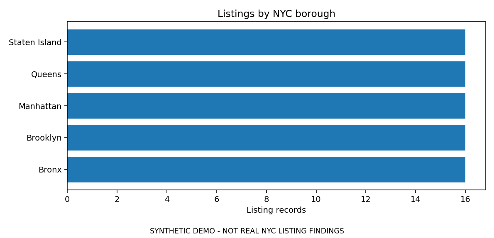

# NYC Airbnb Data Analysis

**Reproducible exploratory analysis of listing prices, room types, availability and neighbourhood patterns.**

Original 2023 notebook by **Priyank Raval**, also published on [Kaggle](https://www.kaggle.com/code/priyankraval/airbnb-data-analytics-final-project-ipynb). · [Kaggle profile](https://www.kaggle.com/priyankraval) · [GitHub profile](https://github.com/ravalpriyankm).

[](https://github.com/ravalpriyankm/New-York-City-Airbnb-Analytics-Dataset/actions/workflows/tests.yml)


This repo preserves an original 2023 notebook and provides a **2026 reproducibility refresh** with a portable Python package, a clean notebook, offline demonstration, validation and automated tests. It is a learning and exploratory analysis project, not an Airbnb product or a source of official booking statistics.

> **Accuracy note:** Availability in the next 365 days is *not* nights booked; minimum stay is *not* number of bookings. Charts here never label either as occupancy or revenue. The synthetic demo contains fictional listings and no real-world findings.

## Quick start (offline demonstration)

Python 3.10+ on Windows, macOS or Linux:

```bash
python -m venv .venv
# macOS / Linux: source .venv/bin/activate
# Windows PowerShell: .venv\Scripts\Activate.ps1
python -m pip install -e ".[dev]"
python -m nyc_airbnb demo --out demo-output
python -m pytest -q
```

The demo writes synthetic records, aggregate CSV tables, data-quality diagnostics and four PNG charts into `demo-output/`. Package installation may need internet access once; the analysis itself runs locally.

## Synthetic preview



*Illustrative output created from fabricated records. It is **not** a finding about New York City.*

## Analysing the original source dataset

The [original notebook on my Kaggle account](https://www.kaggle.com/code/priyankraval/airbnb-data-analytics-final-project-ipynb) uses **Arian Azmoudeh, Airbnb Open Data (Kaggle)**: <https://www.kaggle.com/datasets/arianazmoudeh/airbnbopendata>. Download the CSV yourself and save it at `data/raw/Airbnb_Open_Data.csv`. This project does **not** bundle or silently download the source dataset.

```bash
python -m nyc_airbnb analyse --input data/raw/Airbnb_Open_Data.csv --out reports/real-data
# Optional: produce an analysis-safe, limited-column export locally
python -m nyc_airbnb clean --input data/raw/Airbnb_Open_Data.csv --out data/processed/cleaned.csv
```

Outputs include `quality.json` (validity and missingness), borough and room-type counts, price medians, cancellation-policy frequencies, availability summaries and clearly titled figures. These are **listed prices**, not realised transaction values. Do not publish output containing real records without checking the original dataset licence and privacy implications.

For notebook users, open [`notebooks/quickstart.ipynb`](notebooks/quickstart.ipynb). The old notebook is preserved with outputs cleared at [`archive/original_2023_analysis.ipynb`](archive/original_2023_analysis.ipynb).

## GitHub and Kaggle provenance

This repository and the [original Kaggle notebook](https://www.kaggle.com/code/priyankraval/airbnb-data-analytics-final-project-ipynb) describe the **same historical 2023 analysis**, but they have different purposes. The original Kaggle version was published around 2023 and retains its original analysis choices. The maintained GitHub package is a **2026 technical refresh**, with corrected variable definitions, tests and offline examples. Its synthetic charts are not re-runs of the original dataset.

The Kaggle notebook page lists an **Apache-2.0 notebook licence**. The GitHub repository's original `LICENSE` is **MIT**. These are separate publication contexts; the dataset's licence is a third question. See [Kaggle integration](docs/KAGGLE.md) and [licensing notes](docs/LICENSES_AND_PROVENANCE.md).

## What changed from the 2023 notebook

- Removed a personal, absolute Windows dataset path.
- No blanket median imputation or invented `Unknown` categories.
- Converted USD price strings conservatively; reported invalid and missing values.
- Corrected `availability_365` and `minimum_nights` misinterpretations.
- Corrected borough spelling, retaining missing values where evidence is absent.
- Added separate price *median* and mean summaries, synthetic figures and validation.
- Sanitised spreadsheet-facing CSV text cells to reduce formula-injection risks.
- Removed notebook execution outputs, preserving the historical study without claiming the old figures were revalidated.

See [review notes](docs/REVIEW_NOTES.md), [methods and limits](docs/METHODS.md), [data provenance](data/README.md), and [Kaggle integration](docs/KAGGLE.md).

## Project layout

```text
nyc_airbnb/        Package: cleaning, reporting, plotting, CLI, demo
notebooks/         Reproducible quickstart using synthetic data
archive/           Historical 2023 notebook (not maintained)
data/              Dataset provenance; synthetic fixture; ignored raw data
examples/          Figures from synthetic data, clearly labelled
reports/           Generated locally and ignored by Git
tests/             Regression tests
.github/           CI and contributor templates
```

## Contributing and licensing

Contributions to documentation, tests, method checks and visualisation accessibility are welcome. See [CONTRIBUTING.md](CONTRIBUTING.md), open an Issue or propose a pull request. Please don't upload complete real datasets or disclose identifying listing information.

**Software licence:** MIT (original `LICENSE` retained). The Kaggle dataset, screenshots and third-party materials are governed separately by their respective rights holders. Confirm upstream reuse conditions before redistribution. This is not affiliated with or endorsed by Airbnb, Kaggle or Inside Airbnb.

**Author:** Priyank Raval · [GitHub](https://github.com/ravalpriyankm) · [Kaggle](https://www.kaggle.com/priyankraval) · [LinkedIn](https://www.linkedin.com/in/priyank-raval-ab8143173/)
